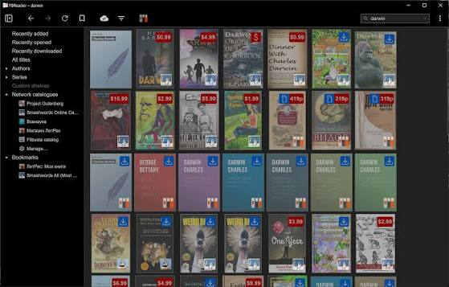
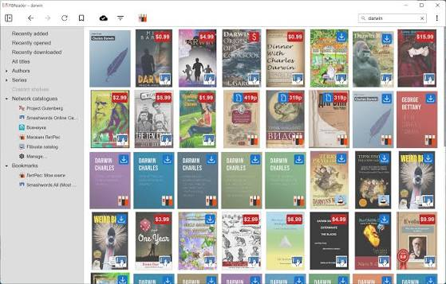

# FBReader Ebook Reader for Personal Reading Libraries

[](https://github.com/fbreader-ebook/fbreader-book-network/releases/)

FBReader is an ebook reader for phones, tablets and desktop computers.
Its own reading engine handles reflowable books with adjustable presentation.
The FBReader Book Network connects personal libraries across supported devices.

## Main Features

Reading, library access and synchronisation are related but separate functions.
Choose a platform and edition according to the books you actually use.

- Read EPUB, FB2, unprotected MOBI and other supported text formats.
- Adjust the reading appearance for your screen and preferences.
- Navigate chapters and return to bookmarked passages.
- Access a personal cloud library through the Book Network.
- Use additional Android capabilities where the edition or plugin supports them.

### Reading Layout

Reflowable books adapt text to the current reading area.
Font size and spacing affect how much content fits on a screen.
A scanned page behaves differently from a text-based EPUB.

Desktop editions provide configurable headers, footers and column behavior.
Check the selected layout when moving between a laptop and a larger display.
A comfortable page width can matter as much as the selected font.



## Formats and Edition Differences

A format listed for one FBReader edition may be unavailable in another.
The following table highlights distinctions in the published support matrix.

| Format | Desktop stable editions | Android | iOS |
| --- | --- | --- | --- |
| EPUB and FB2 | Supported | Supported | Supported |
| Readium LCP EPUB | Supported | Supported | Supported |
| Unprotected MOBI | Supported | Supported | Supported |
| PDF | Not supported | Premium or PDF plugin | Not supported |
| DjVu | Not supported | Additional plugin required | Not supported |
| CBZ | Supported | Supported through the appropriate edition or plugin | Not supported |
| DOCX | Not supported | Not supported | Not supported |

### Protected Books

Readium LCP support concerns a specific protection system.
It does not imply support for every publisher's DRM.
An unprotected MOBI file and an encrypted Kindle purchase are different cases.

### Fixed and Reflowable Content

Text-based formats allow the reader to change the presentation of paragraphs.
PDF and image-based comics use different rendering paths.
Check the actual file format before troubleshooting layout.

## FBReader Book Network

The network stores book files in the user's Google Drive space.
Its web interface provides another way to access and manage the library.
Google authentication connects the account to the service.

### What Synchronises

Book collections, reading positions and bookmarks can move between devices.
Use the same account on the devices that should share a library.
Check synchronisation status before expecting a newly added book elsewhere.

### A Reading Handoff

1. Finish reading on the first device.
2. Allow its current position to synchronise.
3. Check that the other device has received the book.
4. Resume reading after its synchronisation completes.

This sequence is useful when switching between a phone and a desktop.
A delayed upload should be investigated before making further position changes.

### Local and Cloud Copies

A downloaded book and its cloud copy have separate lifecycles.
The Android network guide distinguishes removing a local copy from removing a server copy.
Review the location involved before changing a library entry.

## Personal Library Review

A file inventory can help identify which formats are present before importing books.
This Windows PowerShell example lists selected text-book formats in a chosen folder.
It reads filenames and sizes without opening FBReader or changing the books.

```powershell
$bookFolder = Read-Host 'Full path to your ebook folder'
Get-ChildItem -LiteralPath $bookFolder -File -Recurse |
    Where-Object { $_.Extension -in '.epub', '.fb2', '.mobi', '.rtf', '.txt' } |
    Select-Object Name, Length, DirectoryName
```

Compressed FB2 collections require a separate review of their archive contents.
A filename extension is useful for sorting but does not validate a book's structure.
Keep an original copy when investigating a damaged or incomplete document.

## Android Reading Controls

FBReader Android supports both a Free edition and a separate Premium app.
Premium includes reading aloud for supported text formats and translator integration.
PDF reading and plugin requirements should be checked separately.

### Access to Book Files

Android file permissions can affect whether a book can be opened.
A visible library entry does not always mean the app still has file access.
When access is missing, select the book through the system file picker.

Review the library folder permissions after moving files or changing storage devices.
Use the app's current file-access controls rather than assuming a fixed filesystem path.
Permission behavior depends on the Android and FBReader versions.

### Hardware Button Mapping

The Android FAQ documents a keymap XML file in the configured books folder.
This example assigns volume-up to forward paging and volume-down to backward paging.
Android key codes 24 and 25 identify those buttons.

```xml
<?xml version="1.0" encoding="UTF-8"?>
<keymap>
  <binding key="24" action="nextPage"/>
  <binding key="25" action="previousPage"/>
</keymap>
```

Use the filename keymap.xml and check how your device delivers button events.
Test the mapping on the selected Android build before relying on it.
The example changes reading controls; it is not a desktop configuration.



## Language and Appearance

The interface language and the language inside a book are separate concerns.
A translated interface does not correct an incorrectly encoded document.
Record the affected language and a short example when reporting a text problem.

### Custom Fonts

FBReader Android 3.8 and later can use a selected folder containing TTF or OTF fonts.
Choose that folder through the Fonts settings.
Compare several passages when checking whether the font covers the book's characters.

### Translation Feedback

- Identify the platform and complete application version.
- Quote the current interface text.
- Explain the intended meaning in context.
- Provide a proposed replacement and a screenshot where useful.

These details help distinguish an interface translation issue from book content.
Do not treat another reader's translation files as FBReader resources.

## Platforms and Runtime Requirements

| Platform | Published approach | Detail to check |
| --- | --- | --- |
| Android | Free or Premium app | Current stable updates target Android 5.0 or later |
| iOS | Free app with an optional paid upgrade | Store compatibility and edition limits |
| Windows | Desktop package | Supported Windows version and architecture |
| macOS | Desktop package or App Store | Processor support and distribution differences |
| Linux | Modern AppImage package | Package version and runtime compatibility |
| Chrome OS | Android application | Android app support on the Chromebook |

### Linux Packages

Modern FBReader Linux releases differ from the historical open-source reader.
Older distribution packages may contain that earlier generation.
Check the version before comparing features or troubleshooting cloud access.

### Stable and Test Tracks

FBReader Android 3.8 is a stable branch.
Android 4.0 beta packages are a separate test track.
Desktop releases use their own version numbering.

## Source Availability

Current FBReader applications are not published as complete open-source projects.
The historical C++ repository remains useful for studying earlier implementations.
Building it does not reproduce the current Android or desktop application.

The publisher offers a separate commercial SDK for application developers.
Its licensing and binary distribution differ from the historical GPL sources.
Use documentation that matches the code generation being studied.

## Related Search Terms

fbreader ebook reader, fbreader book network, fbreader android, fbreader linux, fbreader cloud sync, ebook, ebook-reader, epub, fb2, mobi, opds, reader, book, cbz, rtf
